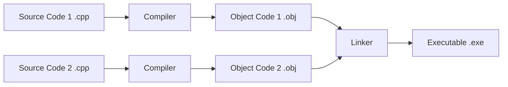

## **C++ BASICS**
* C++ is a compiled language.

* Source code (.cpp) -> Object file (.obj) -> Executable (.exe)
* Compiler converts source code into machine code (object files).
* Linker combines all object files and libraries.
* For large projects, files are compiled separately and then linked.
* **Portability:** *Source code* can run on different systems after recompilation.

---

**C++ Components:**
1. Core Language: int, char, if, for, while
2. Standard Library: vector, string, map, getline()

---
* **Statically Typed language:** Type must be known at compile time. For Eg
```cpp
int age=30;
string name = "Ali";
```
* **C++:** Execution starts from `main()` function.
* **Python:** Execution starts from the first line of the script.
